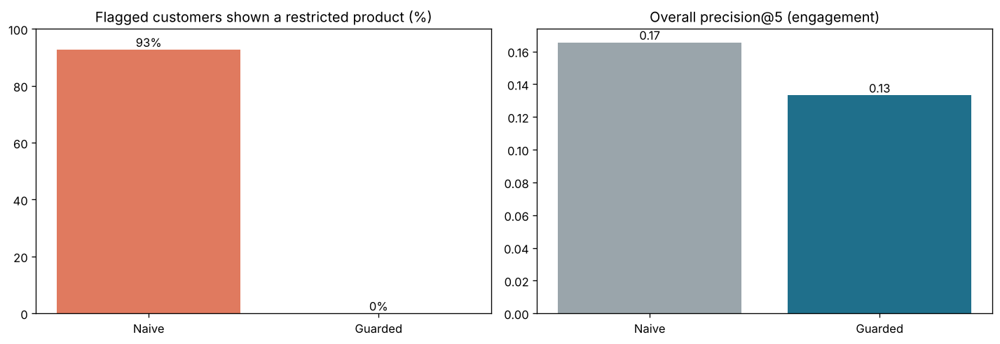
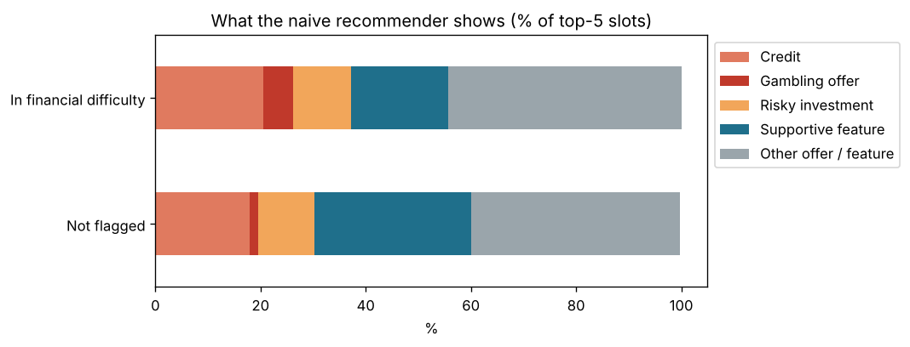

# Personalised Offers Recommender for a UK Fintech App

**An accurate recommender can still be harmful.** This project builds a personalised recommendation engine for a UK fintech app, shows that optimising for engagement pushes credit and gambling offers to customers already in financial difficulty, and then fixes it with a guardrail layer based on the FCA's Consumer Duty.



## The problem

Fintech apps recommend things to customers: cashback offers, app features, credit cards, loans, investments. The standard approach is **collaborative filtering** — "customers like you engaged with this".

But in financial services, engagement and good outcomes are not the same thing. In this (synthetic) data, customers in financial difficulty are **far more likely to activate** high-cost credit and gambling offers, and then **far more likely to miss payments afterwards**:

| | Activated high-risk credit | Missed a payment within 6 months of taking credit |
|---|---|---|
| Not flagged | 24% | ~5% |
| In financial difficulty | **72%** | **~34%** |

A recommender trained on engagement learns that these customers "like" debt — and shows them more.

Since July 2023, the FCA's **Consumer Duty** requires UK firms to act in good faith, **avoid causing foreseeable harm**, and enable customers to pursue their financial objectives, across four outcomes: products & services, price & value, consumer understanding and consumer support.

## Approach

1. **SQL** (`sql/`) — flag customers showing signs of financial difficulty (persistent overdraft, missed payments, high gambling spend, high-cost credit use), with readable reason codes.
2. **Recommender** — compare four algorithms with the [Surprise](https://surpriselib.com) library (random, baseline, item-based KNN, SVD), using 5-fold cross-validation and top-5 ranking metrics. Tuned SVD wins.
3. **Harm audit** — measure who the "naive" SVD recommender shows what to.
4. **Consumer Duty guardrails** — a reviewable rules layer on top of the model:

| Rule | What it does | Consumer Duty link |
|---|---|---|
| R1 | Flagged customers never see credit, gambling offers, crypto or stocks & shares | Avoid foreseeable harm |
| R2 | Credit and risky investments only appear after an affordability check, max one per list — never just because "similar customers liked it" | Products & services |
| R3 | Flagged customers always get a supportive feature (budgeting, savings, free debt advice, gambling block) | Consumer support |
| R4 | Every recommendation shows a plain-English reason | Consumer understanding |

## Results

**Model selection** (5-fold CV, engagement score 1–5)

| Model | RMSE | Precision@5 | Recall@5 |
|---|---|---|---|
| Random | 1.459 | 0.056 | 0.213 |
| BaselineOnly | 0.978 | 0.125 | 0.480 |
| KNN (item-based) | 1.128 | – | – |
| **SVD (tuned)** | **0.925**\* | **0.165** | **0.617** |

\*default SVD in 5-fold CV; ranking metrics use the tuned model on a held-out 20%.

**Naive vs guarded**

| Metric | Naive SVD | With guardrails |
|---|---|---|
| Flagged customers shown a restricted product | 92.7% | **0%** |
| Flagged customers shown a supportive feature | 43.8% | **100%** |
| Customers shown credit/risky investment without passing affordability | 54.6% | **0%** |
| Precision@5 (all customers) | 0.165 | 0.133 (−20%) |
| Precision@5 — not flagged | 0.163 | 0.148 |
| Precision@5 — in financial difficulty | 0.172 | 0.094 |

The engagement cost lands mostly on flagged customers (23% of customers, ~60% of the drop) — they're no longer shown the credit and gambling offers that were linked to missed payments. **That lost engagement is the point.**



## Key takeaways
1. Optimising engagement alone can produce outcomes a UK firm couldn't defend under the Consumer Duty.
2. Simple, explainable rules removed the harmful exposure completely at a modest overall cost.
3. Success metrics for recommenders in financial services should include **outcomes** (arrears, complaints, use of support tools), not just clicks.

## Project structure

```
├── data/
│   ├── generate_data.py           # creates the synthetic data (fixed seed)
│   ├── customers.csv              # 6,000 customers + financial-resilience signals
│   ├── catalogue.csv              # 31 items: offers, features, credit, investments
│   └── engagement.csv             # ~60,000 customer x item engagement scores (1-5)
├── sql/
│   ├── 01_vulnerability_flags.sql
│   └── 02_engagement_vs_outcomes.sql
├── notebooks/
│   ├── 01_data_sql_and_problem.ipynb
│   ├── 02_recommender_models.ipynb
│   ├── 03_harm_audit.ipynb
│   └── 04_consumer_duty_guardrails.ipynb
├── src/recsys.py                  # shared code: SQL loading, ranking, guardrails, metrics
├── results/
│   ├── guarded_recommendations.csv   # Power BI-ready export, one row per recommendation
│   └── *.json                        # saved metrics
└── images/
```

## How to run

```bash
pip install -r requirements.txt
jupyter notebook          # run notebooks 01 -> 04 in order
```

If `scikit-surprise` fails to install with pip, use `conda install -c conda-forge scikit-surprise`.

## Limitations
- **Synthetic data.** The flag thresholds, affordability check and behaviour patterns are simplified assumptions, not real UK statistics.
- **Financial signals only.** FCA vulnerability also covers health, life events and capability, which usually come from customer conversations rather than transaction data.
- **Protect, don't target.** Using difficulty flags to protect customers is very different from using them to target customers; a real firm would need data protection, fairness and compliance review.
- This is a portfolio project, not legal or compliance advice.

## Next steps
- Outcome-aware training (penalise items linked to later arrears) rather than only filtering afterwards
- Fairness checks across age band and region
- A Power BI monitoring dashboard built on `results/guarded_recommendations.csv`

## Tools
Python, pandas, Surprise (collaborative filtering), SQL (SQLite), Matplotlib, Jupyter.
